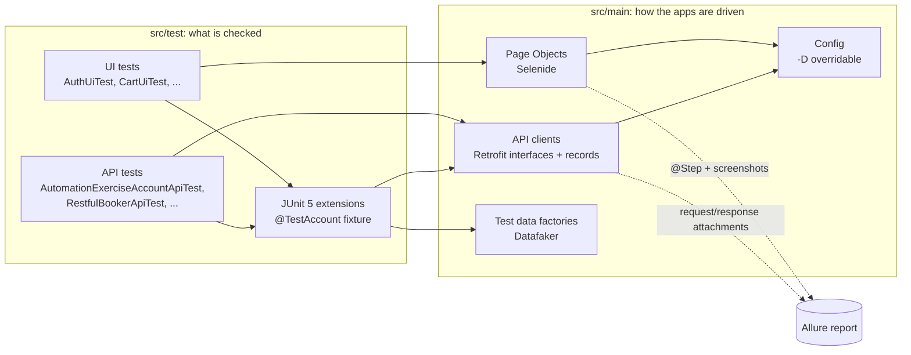

# Test Automation Framework — Selenide + Retrofit

[](https://github.com/dariaMavrova/selenide-retrofit-test-framework/actions/workflows/tests.yml)
[](https://dariamavrova.github.io/selenide-retrofit-test-framework/)

A Java test automation framework for **UI** and **API** testing of real public applications.
It runs on every push and nightly in GitHub Actions and publishes an **[Allure report](https://dariamavrova.github.io/selenide-retrofit-test-framework/)**.

| Application | What is tested | Layer |
|---|---|---|
| [automationexercise.com](https://automationexercise.com), an e-commerce shop | sign-up, login/logout, search, product pages, cart; full account lifecycle and catalogue via API | UI + API |
| [restful-booker](https://restful-booker.herokuapp.com/apidoc/index.html), a hotel booking API | token auth, booking CRUD, filtering, authorization rules | API |
| [the-internet.herokuapp.com](https://the-internet.herokuapp.com/login) | login form, negative cases | UI |

## Architecture



## Engineering practices

The full rules, with the reasoning behind each one and a PR review checklist, are in **[docs/BEST_PRACTICES.md](docs/BEST_PRACTICES.md)**.

**Test design**
- **UI and API in one test.** Preconditions are created through the API, which is fast and stable,
  the user flow runs in the browser, and the result is verified in the backend. For example,
  `registerThroughUi` signs up in the UI and then checks the stored account through the API.
  UI search results are compared one-to-one with the API's.
- **Fixtures as a JUnit 5 extension.** `@TestAccount Account account` injects a freshly registered user and deletes it
  after the test, whether it passed or not. Tests stay short and contain no setup or cleanup code.
- **Independent, self-cleaning tests.** Every test generates unique data with Datafaker, so tests can run in any order and in parallel.
- **Positive, negative and edge cases**, data-driven with `@ParameterizedTest`, soft assertions where several fields are checked.

**Framework design**
- **Typed API layer.** Each API is a Retrofit interface and payloads are Java records. Cross-cutting concerns
  (auth headers, logging, Allure attachments) are OkHttp interceptors added in one place.
- **Page Object pattern** with fluent navigation (`loginAs()` returns `HomePage`, `viewCart()` returns `CartPage`)
  and components (`Header`, `AddedToCartModal`, `CartRow`). Page objects describe the page, while tests hold the assertions.
- **Configuration** has defaults in one class, and every value can be overridden with `-D` to point at another environment.

**Reliability**
- **Parallel by default.** Test classes run concurrently. Shared state was designed out: Selenide is configured once,
  page objects use absolute URLs instead of a global `baseUrl`, the WebDriver and test data are per thread,
  and fixtures live in the JUnit store of each test.
- **No sleeps and no retries.** Selenide's smart waits handle timing, and actions that depend on AJAX wait for their effect
  (for example, `CartRow.remove()` waits until the row is gone).
- **Known causes of flakiness are removed at the source.** The shop's full-screen Google ads are blocked with Chrome
  `--host-resolver-rules`. Restful-booker resets its data every few minutes, so each test gets a fresh token.
- **Test results are never cached.** These tests hit live systems, so Gradle always re-runs them.

**Reporting and CI**
- **Allure report** with Epic / Feature / Severity, steps from page objects (`@Step`) and Selenide actions,
  full HTTP request/response attachments, and a screenshot plus page source on failure. Passwords are masked.
- **GitHub Actions**: API and UI suites run as parallel jobs, their results are merged into one Allure report and
  published to GitHub Pages. Runs on push, on pull requests and nightly, the last of which catches changes in the apps under test.
- **Dependabot** keeps libraries and GitHub Actions up to date, with versions in one place (`gradle/libs.versions.toml`).

## Tech stack

| Area | Tools |
|---|---|
| Language | Java 21 |
| Build | Gradle (version catalog, Java toolchain) |
| Test runner | JUnit 5 (Jupiter 6), parallel execution |
| UI | Selenide 7, headless Chrome |
| API | Retrofit 3, OkHttp 4, Jackson |
| Test data | Datafaker |
| Assertions | AssertJ, Selenide conditions |
| Reporting | Allure (JUnit 5, Selenide, OkHttp integrations, AspectJ for `@Step`) |
| CI | GitHub Actions, GitHub Pages, Dependabot |

## Project structure

```
src
├── main/java/org/example                 # the framework: reusable, no tests here
│   ├── config/Config.java                # URLs and credentials, overridable with -D properties
│   ├── api
│   │   ├── RetrofitClient.java           # shared OkHttp client, Allure attachments, JSON mapper
│   │   ├── ApiClients.java               # one factory method per API under test
│   │   ├── ApiCalls.java                 # execute a call as an Allure step + status-code check
│   │   ├── ae/                           # AutomationExercise: API interface, models, AccountFactory
│   │   └── booker/                       # Restful-booker: API interface, models, BookingFactory
│   └── ui/pages
│       ├── ae/                           # Header, LoginSignupPage, SignupPage, ProductsPage, CartPage, ...
│       └── herokuapp/                    # LoginPage, SecureAreaPage
└── test
    ├── java/org/example
    │   ├── extensions/                   # @TestAccount fixture (JUnit 5 ParameterResolver)
    │   ├── api/{ae,booker}               # @Tag("api")
    │   └── ui                            # @Tag("ui"); BaseUiTest = browser setup
    │       ├── ae/                       # auth, catalogue, cart
    │       └── herokuapp/
    └── resources                         # junit-platform.properties (parallelism), logging, Allure
```

## Running the tests

Needs JDK 17+ to launch Gradle (Gradle provisions Java 21 itself) and Google Chrome for the UI tests.

```bash
./gradlew test                 # everything
./gradlew apiTest              # API tests only
./gradlew uiTest               # UI tests only
./gradlew test allureReport    # run, then build the Allure report
```

The Allure report is written to `build/reports/allure-report/index.html` and must be served over HTTP to open, for example with
`python3 -m http.server -d build/reports/allure-report`.

Options:

```bash
./gradlew uiTest -Dselenide.headless=false                                   # watch the browser
./gradlew uiTest -Dselenide.browser=firefox                                  # another browser
./gradlew test -Djunit.jupiter.execution.parallel.config.fixed.parallelism=1 # run sequentially
./gradlew apiTest -Dapi.booker.url=https://my-env.example.com/               # another environment
```
